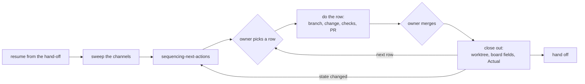

# The AI-driven work loop

How a working session with Claude Code is shaped in this setup, and why. The procedures live in the
skills named below; this page explains how they fit together.

## The loop

`running-a-work-session` is the skill that runs it. Each pass ends with the repo, the board and the
owner's picture of both in agreement, so the next pass starts from facts rather than memory.

## Who decides what

The owner decides which row to take, whether a draft is sent, when to merge, what the Actual was,
and any decision they hold as a named decider. Everything between those points is the agent's: the
branch, the change, the checks, the PR, and the close-out after a merge.

That split is what makes "do row 3" a complete instruction. Asking for permission between steps the
owner already chose costs a round trip and adds nothing; posting something addressed to another
person without being told to costs trust and cannot be undone.

## Why each step is there

- **Sweep before planning.** Sources do not notify each other. An answer in a shared document or a
  design note in a dependency's repo can change what the plan should be, and only reading them finds
  that.
- **A table, not a list.** The sequence separates work from waits on people, states why one row
  comes before another, and traces every row to an issue. The owner can argue with it.
- **One row end to end.** A diff without its PR is not done, and a merge without its close-out
  leaves the board saying something false. Capacity is read off the board, so stale fields distort
  the next plan.
- **Short outward text.** Reviews, comments and messages carry the action. The analysis goes to the
  owner in the session, where it informs the decision without burying the ask.

## How feedback becomes setup

Corrections during a session are first saved as project memory, with the reason and the owner's own
words. When the same correction holds across work, it moves up:

1. **Into a skill's body**, where it costs nothing until that skill runs. Most patterns end here.
2. **Into an always-on rule** only if it passes the residency test in `authoring-instruction-files`:
   frequent, a custom policy the model would not default to, or dangerous when it fails silently.
3. Project-specific facts — people, repos, channels, clients — stay in project memory and are never
   promoted.

## Claude Code facts this depends on

- **Project skills load only from the directory the session starts in**, not from a parent or a
  child. `CLAUDE.md` loads from the start directory and its ancestors. Start a session from the
  directory whose `.claude/skills/` you need.
- **A subject that can read your documentation cannot verify it.** When testing what an agent loads
  or knows, keep the expected answer out of every file it can read.
