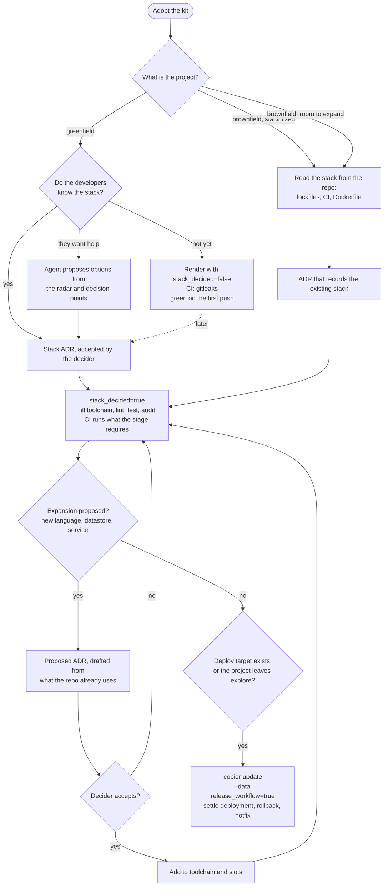

# Shared delivery template

A copier template for the delivery machinery a team shares: the GitHub workflows, process files, runbooks and
scripts that apply the team practices (`../docs/ai-sdlc/practices.md`). Its `copier.yml` sits at the repository root,
because copier versions a template only from the root of a git repository. It chooses no language, database or cloud.
Where a workflow needs the stack, it calls a slot the project fills, and an unfilled slot fails loudly instead of
passing.

## Usage

```bash
uvx copier copy --trust https://github.com/ricoms/praxis-kit.git ./my-new-project
uvx copier copy --trust --defaults --data-file answers.yml https://github.com/ricoms/praxis-kit.git ./my-new-project
cd my-new-project && git init && git add -A && git commit -m "Render the praxis-kit template"
uvx copier update --trust --answers-file .copier-answers.praxis-kit.yml
```

`answers.yml` holds the answers to the questions in [`copier.yml`](../copier.yml), one `name: value` line each.

`copier update` runs only in a git repository whose changes are all committed, so commit the rendered project before
the first update.

The source is the praxis-kit repository's git URL. The answers file records it, and every update resolves it from
there, so anyone with read access to the kit can update the project. A local checkout path would be recorded as
given, and the update would then work only on the machine that has it.

The answers go to `.copier-answers.praxis-kit.yml`, so a stack template applied afterwards can keep its own answers
file; every update names it with `--answers-file`. An update takes praxis-kit's latest release tag, so a template change
reaches projects once it is released. To change an answer later, such as turning on `release_workflow`,
pass `--data release_workflow=true` to the update.

## Hand-over

With `team_delivery`, the rendered project carries `docs/runbooks/hand-over.md`: the checklist for everything the
team does when the repository passes to the client, from deleting the answers file through retiring the team's own
board and secrets to moving access last, each step with how to verify it.

## What it produces

The files this template renders into a project are licensed [MIT-0](LICENSE-MIT-0) (MIT No Attribution), so a
rendered project owes no notice for them.

- `.claude/CLAUDE.md` with the declared tenancy mode and stage, and sections for the stack, modules and flows.
- `.claude/settings.json`, which stops agents editing the frozen foundational tests in `tests/foundational/`.
- `.copier-answers.praxis-kit.yml`, the answers and template commit that `copier update` starts from.
- `docs/agreements.md`, the ten decisions every team settles, with proposed defaults; `docs/slo.md`, `docs/adr/`,
  and the runbooks: CI/CD troubleshooting, the runbook index, incidents, `rotations.log`.
- `.github/workflows/ci.yml`: gitleaks always. With `stack_decided`, `checks` runs `just ci` after
  the toolchain action. With `release_workflow`, `image` builds with `scripts/build-image.sh` and smoke-checks the
  image.
- `justfile` with the recipe contract (`ci`, `lint`, `test`, `audit`, `secrets`, `security-scan`, and `smoke` with
  `release_workflow`), and a stack-free
  two-stage `.pre-commit-config.yaml` and `dependabot.yml`.
- With `release_workflow`: `scripts/build-image.sh`, `scripts/image-smoke.sh`, `scripts/smoke.sh` and
  `.github/smoke.txt`, and `.github/workflows/release.yml` (build once, deploy to dev on a pre-release, promote the
  same digest to prod, roll back through the pipeline) and `docs/runbooks/rollback.md`.
- With `team_delivery`: labels, the issue forms (bug, enhancement, question, client question, decision, risk and
  security test, each applying a kind label), CODEOWNERS, the PR template, a `main` ruleset with its apply script,
  `docs/raci.md`, and the board, review-and-merge, security-testing and hand-over runbooks.

## How CI grows

CI asks only for what the project can already pass, so a fresh render is green on its first push. It grows in three
steps, each triggered by a fact:

1. **At render, any stage.** CI runs the one check that needs no stack: gitleaks.
2. **When the stack is decided.** That means its ADR is accepted, or an existing codebase already runs on it. Fill the
   toolchain, `lint`, `test` and `audit` slots, then pass `--data stack_decided=true` to the update. CI's `checks` job
   runs `just ci`, which runs what the stage asks for: `test` in `explore`, and `lint`, `test` and `audit` after it.
   With `team_delivery`, merge the update and then run `scripts/repo/apply-ruleset.sh` as a repo admin, so the
   ruleset requires `checks` too. The default is already on past `explore`.
3. **When there is a deploy target, or the project leaves `explore`.** Pass `--data release_workflow=true` and settle
   the deployment, rollback and hotfix rows in `docs/agreements.md`. `CONSTITUTION.md` §5 asks for them before the
   first change reaches production, and explore code never reaches production.

Whether the stack is decided depends on how the project starts. `settling-agreements` works this out in its first
step:



## The slots a project fills

| Slot | Called by | What it does |
|---|---|---|
| `.github/actions/toolchain` | CI's `checks` job, once `stack_decided` | Installs the stack's tools; `just` is already there |
| `just lint`, `just test`, `just audit` | `just ci`, which runs only `test` in `explore` | The project's static checks, tests and dependency audits |
| `scripts/build-image.sh TAG` | CI's `image` job, the release's `build` job | Builds the deployable image, which must listen on `$PORT` and answer `GET /health` |
| `IMAGE_REPOSITORY` repo variable | `release.yml` | Where images are pushed |
| `.github/actions/target-setup` | `release.yml` | Logs in to the registry and the target, from repository variables |
| `scripts/deploy.sh current\|release\|revert` | `release.yml` | Reports what serves an environment, deploys an image by digest, routes traffic back |
| `scripts/migrate.sh ENV` (optional) | `release.yml` | Forward-only migration before a release, never on a rollback |

A stack that fills these slots can live in its own template and be applied after this one.
